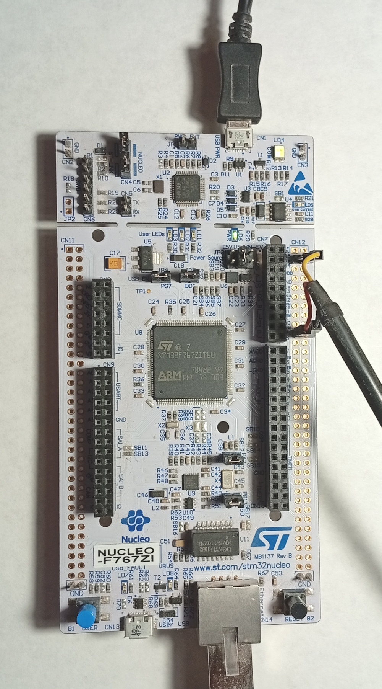

# Nucleo-144 STM32F767ZIT6 Example

This folder contains an example that runs on a Nucleo board from ST which has a physical ethernet MAC. It is a development board by ST which looks like the picture below, and it is fully supported by various development tools by ST.

Thus apart from various things that can be done using a serial port it also has network examples.
The project probably will not properly re-generate from the .ioc file since I have started using the ethernet drivers provided by ST from an earlier version and the new ones don't appear to be compatible with the old API, so I kep using the old ethernet code with never drivers for everything else.
All of my own source code is licensed under the MIT license. I certainly can grant you rights regarding the code I have written, but anything else is not mine to grant you anything.

Drivers installed by the ST tools when a software project is generated seem to be licensed under various other free licenses (the older ones under BDS clause 3 which is fairly close to the MIT license and the new ones are under Apache License v2), please refer to the copyright and license notices in the individual files and the LICENSE.txt file under Drivers for details.

They all seem to be compatible linking with my MIT licensed code, and distributing verbatim copies of the library sources also seems to be permitted by those licenses. But that is about as much I can tell, and even that is not legal advice, since I am not a lawyer, I don't even play one on TV.

If you are developing a commercial product using any of this you probably should hire an actual lawyer to figure out what is legal and what isn't.

To compile the code you need the STM32CubeIDE. Just pull the repos mcu-to-pc-examples and mcu-to-pc-communication (they should sit next to each other in some working directory) and using the STM32CubeIDE open the project under Nucleo-144-STM32F767ZIT6.

